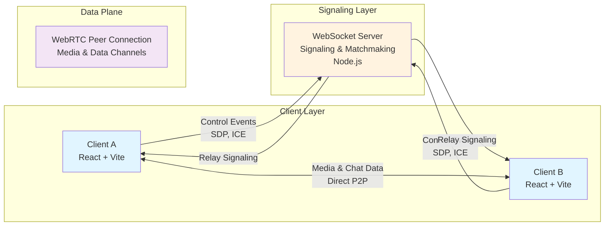
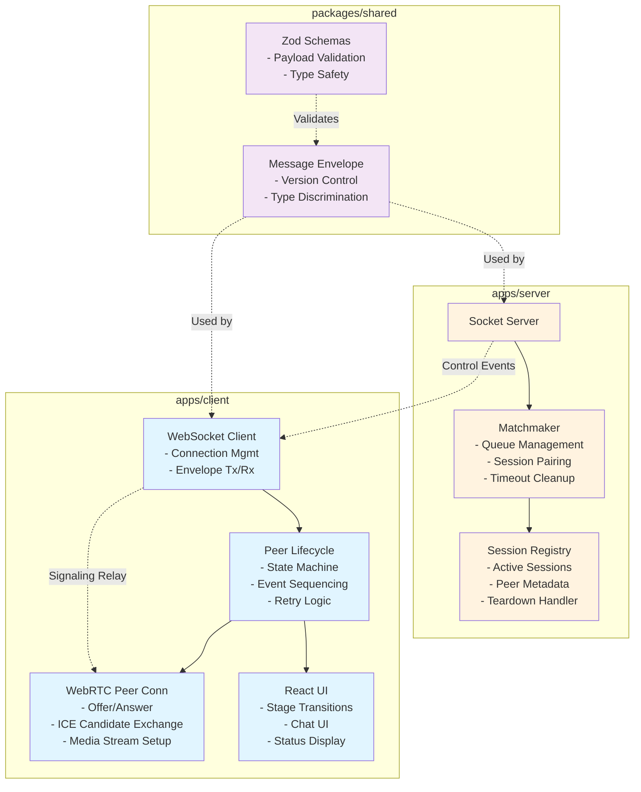
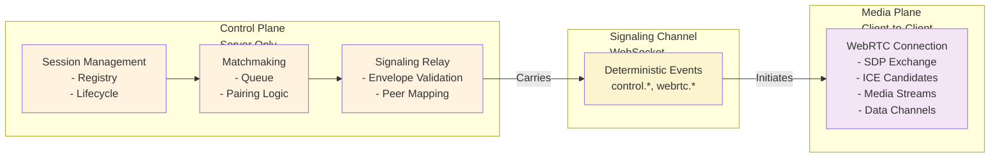
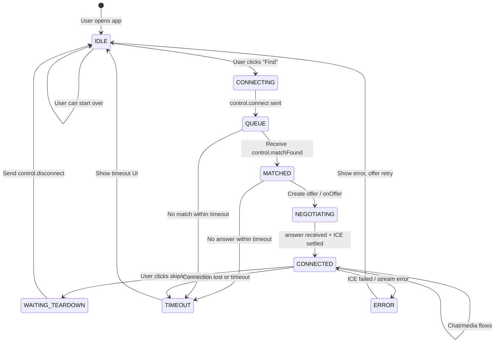
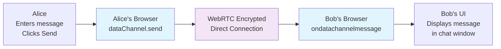
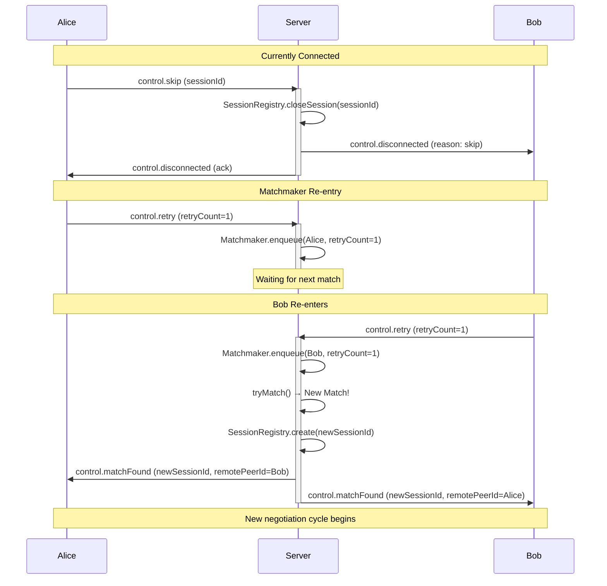
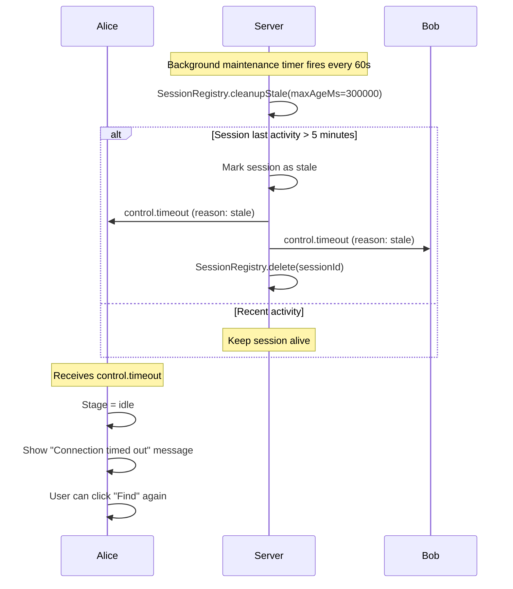
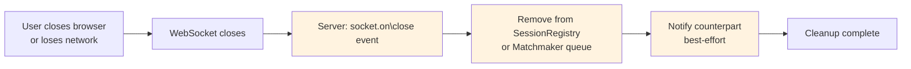

# Strangely: System Design & Architecture

## Overview

**Strangely** is a real-time anonymous peer-to-peer chat system using WebRTC for media transport and a lightweight WebSocket server for signaling and matchmaking. The architecture strictly separates control plane (server) from media plane (client-to-client).

---

## 1. High-Level Design (HLD)

### System Architecture



### Component Diagram



### Layered Architecture



---

## 2. Low-Level Design (LLD)

### 2.1 Message Envelope (Shared Contract)

**Location:** `packages/shared/src/envelope.ts`

```typescript
interface MessageEnvelope<TType, TPayload> {
  version: "v1"; // Protocol versioning
  type: TType; // Discriminated event name
  payload: TPayload; // Type-safe payload
  requestId?: string; // Optional request correlation
  timestampMs: number; // Epoch milliseconds
}

// Runtime validation with Zod
const messageEnvelopeSchema = z.object({
  version: z.literal("v1"),
  type: z.enum([
    "control.connect",
    "control.disconnect",
    "control.timeout",
    "control.skip",
    "control.retry",
    "control.matchFound",
    "webrtc.offer",
    "webrtc.answer",
    "webrtc.iceCandidate",
  ]),
  payload: z.unknown(),
  requestId: z.string().optional(),
  timestampMs: z.number().finite(),
});
```

**Design Rationale:**

- **Versioning**: Protocol evolution without client/server mismatch
- **Discriminated Union**: Type-safe payload dispatch
- **Timestamps**: Diagnostic ordering and timeout calculation
- **RequestId**: Optional correlation for request-response patterns

---

### 2.2 Control Events

**Location:** `packages/shared/src/signaling.ts`

| Event                | Source | Direction | Payload                                    | Purpose                 |
| -------------------- | ------ | --------- | ------------------------------------------ | ----------------------- |
| `control.connect`    | Client | → Server  | `{ peerId, timestamp }`                    | Enter matchmaking queue |
| `control.matchFound` | Server | → Client  | `{ sessionId, localPeerId, remotePeerId }` | Notify match pairing    |
| `control.disconnect` | Client | → Server  | `{ sessionId, reason }`                    | Leave session/queue     |
| `control.skip`       | Client | → Server  | `{ sessionId }`                            | Request next match      |
| `control.retry`      | Client | → Server  | `{ retryCount }`                           | Re-enter matchmaking    |
| `control.timeout`    | Server | → Client  | `{ sessionId, reason }`                    | Session expired         |

**Server-Side Event Handling:**

```typescript
// Pseudocode: socketServer.ts
on("control.connect", (msg, socket) => {
  const peerId = validatePeerId(msg.payload);
  const ticket = matchmaker.enqueue(peerId, socket);
  // Check if match is now possible
  const match = matchmaker.tryMatch();
  if (match) {
    notifyClients(match.clientA, match.clientB);
    sessionRegistry.create(match.sessionId, match);
  }
});

on("control.matchFound", ...)  // relayed by matchmaker
on("control.disconnect", (msg, socket) => {
  sessionRegistry.closeSession(msg.payload.sessionId);
  notifyCounterpart(socket, msg.payload);
});
on("webrtc.offer", (msg, socket) => {
  // Validate session ownership, relay to peer
  relayToPeer(msg.payload.sessionId, msg.payload.fromPeerId, msg);
});
```

---

### 2.3 WebRTC Signaling Events

| Event                 | Direction                    | Payload                                | Semantics                          |
| --------------------- | ---------------------------- | -------------------------------------- | ---------------------------------- |
| `webrtc.offer`        | Client A → Server → Client B | `{ sessionId, fromPeerId, sdp }`       | SDP offer (connection proposal)    |
| `webrtc.answer`       | Client B → Server → Client A | `{ sessionId, fromPeerId, sdp }`       | SDP answer (connection acceptance) |
| `webrtc.iceCandidate` | Both → Server → Other        | `{ sessionId, fromPeerId, candidate }` | ICE candidate (network path)       |

**Media Negotiation Sequence:**

```mermaid
sequenceDiagram
    participant A as Client A<br/>Offerer
    participant S as Signaling<br/>Server
    participant B as Client B<br/>Answerer
    participant WR as WebRTC<br/>Data Channel

    A->>A: Create RTCPeerConnection
    A->>A: Create offer (SDP)
    A->>S: webrtc.offer
    S->>B: webrtc.offer (relayed)
    B->>B: Create RTCPeerConnection
    B->>B: setRemoteDescription(offer)
    B->>B: Create answer (SDP)
    B->>S: webrtc.answer
    S->>A: webrtc.answer (relayed)
    A->>A: setRemoteDescription(answer)

    par ICE Candidates
        A->>S: webrtc.iceCandidate
        S->>B: webrtc.iceCandidate
        B->>S: webrtc.iceCandidate
        S->>A: webrtc.iceCandidate
    end

    par Connection Establishment
        A<-->B: STUN/TURN negotiation
        A<-->B: Connectivity check (STUN)
    end

    A->>WR: Create data channel
    B->>WR: onDataChannel
    A<-->B: RTCDataChannel ready
```

---

### 2.4 Client State Machine

**Location:** `apps/client/src/peerLifecycle.ts`



**State Transitions (Pseudocode):**

```typescript
// apps/client/src/App.tsx
interface PeerLifecycleState {
  stage: "idle" | "searching" | "matched" | "connected";
  sessionId: SessionId | null;
  remotePeerId: PeerId | null;
  lastError: Error | null;
  retryCount: number;
}

// Transition handlers
const onFindClick = () => {
  setStage("searching");
  ws.send(makeEnvelope("control.connect", { peerId: localPeerId }));
};

const onMatchFound = (msg: MessageEnvelope) => {
  setStage("matched");
  sessionId = msg.payload.sessionId;
  remotePeerId = msg.payload.remotePeerId;
  // Auto-create offer
  createOffer();
};

const onAnswerReceived = () => {
  // setRemoteDescription(answer)
  setStage("connected");
  enableChatInput();
};

const onSkip = () => {
  setStage("searching");
  ws.send(makeEnvelope("control.skip", { sessionId }));
  // Server will close session and re-queue peer
};
```

---

### 2.5 Server-Side Session Registry

**Location:** `apps/server/src/sessions/sessionRegistry.ts`

```typescript
interface Session {
  sessionId: SessionId;
  clientASocket: WebSocket;
  clientBSocket: WebSocket;
  clientAPeerId: PeerId;
  clientBPeerId: PeerId;
  createdAt: number;
  lastActivity: number;
  state: "active" | "closed";
}

class SessionRegistry {
  private sessions: Map<SessionId, Session> = new Map();

  create(sessionId: SessionId, clientA: WebSocket, clientB: WebSocket, ...): Session {
    const session: Session = {
      sessionId,
      clientASocket: clientA,
      clientBSocket: clientB,
      clientAPeerId: clientAPeerId,
      clientBPeerId: clientBPeerId,
      createdAt: Date.now(),
      lastActivity: Date.now(),
      state: "active",
    };
    this.sessions.set(sessionId, session);
    return session;
  }

  getSession(sessionId: SessionId): Session | null {
    return this.sessions.get(sessionId) ?? null;
  }

  closeSession(sessionId: SessionId, reason: string): void {
    const session = this.sessions.get(sessionId);
    if (!session) return;

    session.state = "closed";
    // Notify both clients (best-effort)
    sendToSocket(session.clientASocket, {
      type: "control.disconnected",
      payload: { reason },
    });
    sendToSocket(session.clientBSocket, {
      type: "control.disconnected",
      payload: { reason },
    });

    this.sessions.delete(sessionId);
  }

  // Periodic maintenance: clean up stale sessions
  cleanupStale(maxAgeMs: number = 300_000): void {
    const now = Date.now();
    for (const [id, session] of this.sessions) {
      if (now - session.lastActivity > maxAgeMs) {
        this.closeSession(id, "timeout");
      }
    }
  }
}
```

**Design Rationale:**

- Session records bidirectional socket pairs for relay logic
- Timestamps enable timeout detection
- State flag prevents double-close bugs
- Periodic maintenance avoids memory leaks

---

### 2.6 Matchmaker Queue

**Location:** `apps/server/src/matchmaking/matchmaker.ts`

```typescript
interface QueueTicket {
  peerId: PeerId;
  socket: WebSocket;
  enqueuedAt: number;
  retryCount: number;
}

class Matchmaker {
  private queue: QueueTicket[] = [];

  enqueue(
    peerId: PeerId,
    socket: WebSocket,
    retryCount: number = 0,
  ): QueueTicket {
    const ticket: QueueTicket = {
      peerId,
      socket,
      enqueuedAt: Date.now(),
      retryCount,
    };
    this.queue.push(ticket);
    return ticket;
  }

  tryMatch(): {
    sessionId: SessionId;
    clientA: QueueTicket;
    clientB: QueueTicket;
  } | null {
    if (this.queue.length < 2) return null;

    // FIFO: pair oldest two entries
    const clientA = this.queue.shift()!;
    const clientB = this.queue.shift()!;

    const sessionId: SessionId = generateSessionId();

    return { sessionId, clientA, clientB };
  }

  removeFromQueue(socket: WebSocket): void {
    this.queue = this.queue.filter((t) => t.socket !== socket);
  }

  size(): number {
    return this.queue.length;
  }
}
```

**Matching Strategy:**

- FIFO (First-In-First-Out) ensures fairness
- Socket reference enables deterministic dequeuing on disconnect
- Retry count tracks re-entry attempts
- Timestamp enables timeout calculation

---

### 2.7 WebSocket Server Structure

**Location:** `apps/server/src/signaling/socketServer.ts`

```typescript
type SocketContext = {
  peerId: PeerId | null;
  socket: WebSocket;
  sessionId: SessionId | null;
};

function createSocketServer(port: number) {
  const wss = new WebSocketServer({ port });
  const socketContextMap = new WeakMap<WebSocket, SocketContext>();
  const matchmaker = new Matchmaker();
  const sessionRegistry = new SessionRegistry();

  wss.on("connection", (socket) => {
    const ctx: SocketContext = { peerId: null, socket, sessionId: null };
    socketContextMap.set(socket, ctx);

    socket.on("message", async (data: Buffer) => {
      try {
        const msg = JSON.parse(data.toString());
        const envelope = messageEnvelopeSchema.parse(msg);

        switch (envelope.type) {
          case "control.connect": {
            const peerId = envelope.payload.peerId;
            ctx.peerId = peerId;
            matchmaker.enqueue(peerId, socket);

            // Try to form a match
            const match = matchmaker.tryMatch();
            if (match) {
              const ctxA = socketContextMap.get(match.clientA.socket)!;
              const ctxB = socketContextMap.get(match.clientB.socket)!;

              ctxA.sessionId = match.sessionId;
              ctxB.sessionId = match.sessionId;

              sessionRegistry.create(
                match.sessionId,
                match.clientA.socket,
                match.clientB.socket,
                match.clientA.peerId,
                match.clientB.peerId,
              );

              // Notify both clients
              const notifyPayload = {
                sessionId: match.sessionId,
                localPeerId: match.clientA.peerId,
                remotePeerId: match.clientB.peerId,
              };
              sendToSocket(
                match.clientA.socket,
                makeEnvelope("control.matchFound", notifyPayload),
              );

              // Swap for client B's perspective
              const notifyPayloadB = {
                sessionId: match.sessionId,
                localPeerId: match.clientB.peerId,
                remotePeerId: match.clientA.peerId,
              };
              sendToSocket(
                match.clientB.socket,
                makeEnvelope("control.matchFound", notifyPayloadB),
              );
            }
            break;
          }

          case "control.disconnect": {
            const { sessionId } = envelope.payload;
            sessionRegistry.closeSession(sessionId, "client_requested");
            ctx.sessionId = null;
            break;
          }

          case "webrtc.offer":
          case "webrtc.answer":
          case "webrtc.iceCandidate": {
            // Relay to counterpart
            const { sessionId, fromPeerId } = envelope.payload;
            const session = sessionRegistry.getSession(sessionId);
            if (!session) {
              console.warn(`Session ${sessionId} not found for relay`);
              return;
            }

            // Determine counterpart socket
            const isClientA = session.clientAPeerId === fromPeerId;
            const counterpartSocket = isClientA
              ? session.clientBSocket
              : session.clientASocket;

            sendToSocket(counterpartSocket, envelope);
            break;
          }

          default: {
            console.warn(`Unknown message type: ${envelope.type}`);
          }
        }
      } catch (err) {
        console.error("Message handling error:", err);
      }
    });

    socket.on("close", () => {
      const ctx = socketContextMap.get(socket)!;
      if (ctx.sessionId) {
        sessionRegistry.closeSession(ctx.sessionId, "socket_closed");
      } else {
        matchmaker.removeFromQueue(socket);
      }
    });

    socket.on("error", (err) => {
      console.error("WebSocket error:", err);
    });
  });

  // Periodic maintenance
  setInterval(() => {
    sessionRegistry.cleanupStale(300_000); // 5 minutes
  }, 60_000); // check every minute

  return {
    close: async () => {
      // graceful shutdown
      for (const client of wss.clients) {
        client.close();
      }
      await new Promise<void>((resolve) => wss.close(() => resolve()));
    },
  };
}
```

**Design Rationale:**

- **WeakMap for SocketContext**: Automatic cleanup when socket is garbage collected
- **Message validation first**: Drop malformed envelopes immediately
- **SessionId lookup for relay**: Validates session exists before relay
- **Counterpart identification**: Derives from session registry, not client-supplied peerId
- **Best-effort notification**: Doesn't retry if peer socket is already closed
- **Periodic cleanup**: Prevents unbounded session accumulation

---

## 3. End-to-End Flows

### 3.1 Match & Connect Flow

```mermaid
sequenceDiagram
    participant Alice as Alice<br/>Browser
    participant Server as Signaling<br/>Server
    participant Bob as Bob<br/>Browser

    Note over Alice,Bob: Discovery Phase
    Alice->>Alice: Click "Find"
    Alice->>Alice: Create RTCPeerConnection
    Alice->>Server: control.connect (peerId)
    activate Server

    Bob->>Bob: Click "Find"
    Bob->>Bob: Create RTCPeerConnection
    Bob->>Server: control.connect (peerId)

    Server->>Server: Matchmaker.enqueue(Alice)
    Server->>Server: Matchmaker.enqueue(Bob)
    Server->>Server: tryMatch() → Match found!
    Server->>Server: SessionRegistry.create(sessionId)

    Server->>Alice: control.matchFound<br/>(sessionId, remotePeerId=Bob)
    Server->>Bob: control.matchFound<br/>(sessionId, remotePeerId=Alice)
    deactivate Server

    Note over Alice,Bob: Negotiation Phase
    Alice->>Alice: Create SDP offer
    Alice->>Server: webrtc.offer (offer SDP)
    Server->>Bob: webrtc.offer (relayed)

    Bob->>Bob: setRemoteDescription(offer)
    Bob->>Bob: Create SDP answer
    Bob->>Server: webrtc.answer (answer SDP)
    Server->>Alice: webrtc.answer (relayed)

    Alice->>Alice: setRemoteDescription(answer)

    Note over Alice,Bob: ICE Candidate Exchange
    par ICE Gathering
        Alice->>Alice: onicecandidate event fires
        Alice->>Server: webrtc.iceCandidate
        Server->>Bob: webrtc.iceCandidate (relayed)
        Bob->>Bob: addIceCandidate()
    and
        Bob->>Bob: onicecandidate event fires
        Bob->>Server: webrtc.iceCandidate
        Server->>Alice: webrtc.iceCandidate (relayed)
        Alice->>Alice: addIceCandidate()
    end

    Note over Alice,Bob: Connection Established
    Alice->>Alice: onconnectionstatechange → connected
    Bob->>Bob: onconnectionstatechange → connected
    Alice->>Alice: Create data channel
    Bob->>Bob: ondatachannel event fires

    Alice<-->Bob: RTCDataChannel ready for chat
```

---

### 3.2 Chat Message Flow (Post-Connection)



**Key Point:** Messages are encrypted end-to-end by WebRTC and never transit through the server.

---

### 3.3 Skip & Rematch Flow



---

### 3.4 Timeout & Cleanup Flow



---

### 3.5 Disconnect & Cleanup Flow



---

## 4. Data Structures & Key Contracts

### 4.1 Shared Type Definitions

**Location:** `packages/shared/src/session.ts`

```typescript
export type SessionId = string & { readonly __brand: "SessionId" };
export type PeerId = string & { readonly __brand: "PeerId" };

export function createSessionId(): SessionId {
  return `session-${crypto.randomUUID()}` as SessionId;
}

export function createPeerId(): PeerId {
  return `peer-${crypto.randomUUID().slice(0, 8)}` as PeerId;
}
```

**Nominal Typing Benefit:** Prevents accidental swapping of `SessionId` and `PeerId`.

---

### 4.2 Control Event Payloads

```typescript
// control.connect
export interface ConnectPayload {
  peerId: PeerId;
}

// control.matchFound
export interface MatchFoundPayload {
  sessionId: SessionId;
  localPeerId: PeerId;
  remotePeerId: PeerId;
}

// control.disconnect
export interface DisconnectPayload {
  sessionId: SessionId;
  reason?: string;
}

// control.skip
export interface SkipPayload {
  sessionId: SessionId;
}

// control.retry
export interface RetryPayload {
  retryCount: number;
}

// control.timeout
export interface TimeoutPayload {
  sessionId: SessionId;
  reason: string;
}
```

---

### 4.3 WebRTC Signaling Payloads

```typescript
// webrtc.offer
export interface OfferPayload {
  sessionId: SessionId;
  fromPeerId: PeerId;
  sdp: string; // RTCSessionDescription.sdp
}

// webrtc.answer
export interface AnswerPayload {
  sessionId: SessionId;
  fromPeerId: PeerId;
  sdp: string;
}

// webrtc.iceCandidate
export interface IceCandidatePayload {
  sessionId: SessionId;
  fromPeerId: PeerId;
  candidate: {
    candidate: string;
    sdpMLineIndex?: number;
    sdpMid?: string;
  };
}
```

---

## 5. Architectural Principles & Tradeoffs

### 5.1 Separation of Concerns

| Responsibility                      | Owner                     | Rationale                                                         |
| ----------------------------------- | ------------------------- | ----------------------------------------------------------------- |
| **Signaling** (SDP, ICE relay)      | Server (WebSocket)        | Deterministic peer identification, rate limiting, spam prevention |
| **Media/Data** (audio, video, chat) | Client-to-Client (WebRTC) | End-to-end encryption, lower latency, reduced server bandwidth    |
| **Session State**                   | Server (Registry)         | Canonical source of truth for active pairs                        |
| **Matchmaking**                     | Server (Matchmaker)       | Prevents client collusion, fair queue ordering                    |
| **Lifecycle State**                 | Client (State Machine)    | Decoupled from server; retry logic survives network hiccups       |

---

### 5.2 Resilience Patterns

1. **Idempotent Control Events**: `control.disconnect` with session ID is safe to retry.
2. **Timeout Cleanup**: Stale sessions are garbage-collected by background maintenance.
3. **Best-Effort Notifications**: If counterpart socket is closed, relay fails gracefully.
4. **Client-Side Retry**: If server goes down, client state machine survives and can reconnect.
5. **Nominal Types**: `SessionId` and `PeerId` branding prevents type confusion bugs.

---

### 5.3 Scalability Considerations

| Concern                   | Current Design                      | Scaling Strategy                                          |
| ------------------------- | ----------------------------------- | --------------------------------------------------------- |
| **Single server process** | All sessions + matchmaker in memory | Shard by peer hash; use Redis for session registry        |
| **Queue fairness**        | FIFO (O(n) per match)               | Segment queue by latency/region; use priority queues      |
| **Session cleanup**       | Periodic scan every 60s             | Event-driven TTL with Redis expiry                        |
| **Media relay**           | None (peer-to-peer)                 | Optional selective forwarding (SFU) if peer-to-peer fails |

---

### 5.4 Tradeoffs

**Pro: Direct P2P Media**

- Low latency for chat
- No server bandwidth cost
- End-to-end encryption
- Scalability (O(1) per connection)

**Con: Direct P2P Media**

- Firewall/NAT traversal complexity (mitigated by STUN/TURN)
- Peer-to-peer discoverability requires signaling server

**Pro: Lightweight Signaling Server**

- Easy to operate (single Node.js process)
- Fast iteration on matchmaking logic
- Cheap to run

**Con: Lightweight Signaling Server**

- Single point of failure (no HA)
- All state in-memory (no persistence)
- Limited to one machine's capacity

---

## 6. Key Design Decisions

### Decision 1: Envelope Versioning

**Problem:** Protocol evolution without breaking clients.

**Solution:** All messages wrap in versioned `MessageEnvelope` with discriminated `type`.

**Rationale:**

- Old client + new server: new server ignores unknown event types
- New client + old server: client detects version mismatch and falls back
- Forward/backward compatibility window

---

### Decision 2: Server-Side Peer Identity

**Problem:** Client could lie about its peerId when relaying.

**Solution:** Server binds peerId to WebSocket at `control.connect` and uses that binding for all relay decisions, ignoring client-supplied `fromPeerId` in validation.

**Rationale:**

- Prevents peer impersonation attacks
- Simplifies session state management
- Deterministic behavior

---

### Decision 3: FIFO Queue Matching

**Problem:** How to pair peers fairly?

**Solution:** Dequeue oldest two peers on each match opportunity.

**Rationale:**

- Simple O(2) operation per match
- Fair (no starvation)
- Predictable for testing

**Caveat:** Not latency-aware; could pair geographically distant peers.

---

### Decision 4: Best-Effort Relay

**Problem:** What if relay target socket is already closed?

**Solution:** Log and ignore; client timeout handlers catch the failure.

**Rationale:**

- Avoid blocking on closed sockets
- Simplifies error recovery on client
- Reduces retry storms

---

## 7. Interview Talking Points

### Strengths to Emphasize

1. **Clean Architecture**: Strict separation of control (server) and media (peer) planes eliminates coupling.
2. **Type Safety**: Nominal types (`SessionId`, `PeerId`) prevent mixing identifiers.
3. **Deterministic Behavior**: No randomness in queue matching; easier to debug and test.
4. **Scalability Path**: Clear roadmap (Redis sessions, peer sharding, optional SFU).
5. **Anonymous Safety**: Server never stores user data; only transient session state.

### Questions to Anticipate

**Q: How do you prevent DDoS on the signaling server?**

- Rate-limit per-socket connection frequency
- Validate message envelope before processing
- Drop malformed messages immediately

**Q: What if two clients send conflicting offers?**

- Server enforces role: first to send offer is offerer, second is answerer
- Can use sessionId timestamp to break ties

**Q: How do you handle NAT traversal?**

- STUN servers discover public IP:port
- TURN servers relay if peer-to-peer is blocked
- RTC configuration includes STUN/TURN candidates

**Q: Can you add group chat?**

- Current design is 1-to-1 only
- Extend `matchFound` payload to include N peers
- Clients create N data channels (one per peer)
- Potential: use SFU (Selective Forwarding Unit) for many-to-many media

**Q: What if a peer goes offline mid-session?**

- WebSocket close event triggers session cleanup
- Counterpart receives `control.timeout` or `control.disconnected`
- Peer re-enters matchmaking on reconnect

---

## 8. Testing Strategy

### Unit Tests

- **Envelope validation** (`envelope.test.ts`): Zod schema coverage
- **Matchmaker** (`matchmaker.test.ts`): FIFO pairing, queue edge cases, dequeue
- **Socket server** (`socketServer.test.ts`): Message dispatch, session lifecycle, cleanup

### Integration Tests

- **End-to-end flow**: Client A → Server → Client B → chat message
- **Timeout/disconnect**: Verify cleanup and counterpart notification
- **Skip/retry**: Queue re-entry and new match formation

### Manual Testing

- Real WebRTC browsers (Chrome, Firefox)
- Network fault injection (packet loss, latency)
- Concurrent match attempts (queue stress)

---

## 9. Future Enhancements

| Feature                          | Effort | Impact                                           |
| -------------------------------- | ------ | ------------------------------------------------ |
| Persistent session store (Redis) | Medium | Enables HA, session recovery                     |
| Latency-aware pairing            | Medium | Better UX (lower latency matches)                |
| Group chat (N-to-N)              | High   | Expands use case; requires SFU or mesh topology  |
| Message history                  | High   | Violates anonymous design; needs careful UX      |
| User moderation                  | Medium | Report/block controls; need identity abstraction |
| Analytics dashboard              | Low    | Server metrics, queue depth, match latency       |

---

## 10. Conclusion

**Strangely** demonstrates:

- **Clean architecture** through strict plane separation
- **Type-safe contracts** with runtime validation
- **Scalable signaling** using industry-standard WebRTC + WebSocket patterns
- **Minimal operational overhead** (single Node.js process, in-memory state)
- **Path to production** (HA, persistent storage, regional sharding)

This is a production-ready blueprint for real-time P2P applications.
