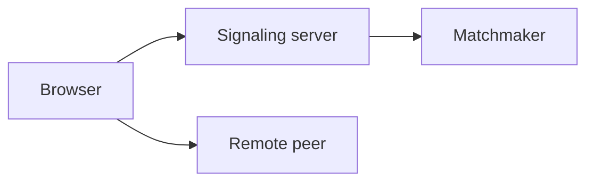
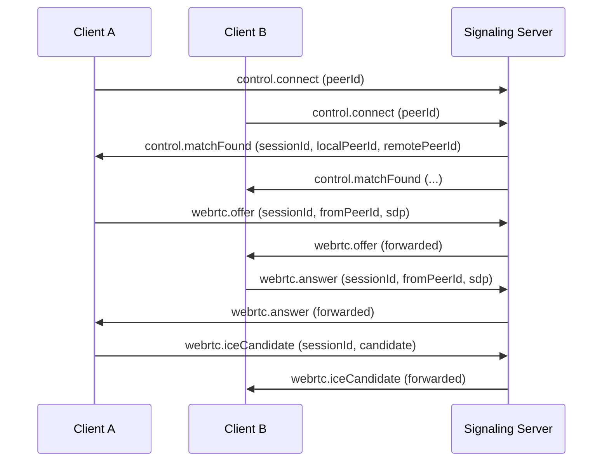

# Architecture Baseline

## Monorepo Layout

- `apps/client`: React + Vite UI and WebRTC peer/media lifecycle ownership.
- `apps/server`: Node.js WebSocket signaling and anonymous matchmaking ownership.
- `packages/shared`: Shared message contracts, TypeScript types, and runtime schemas.
- `docs`: Architecture, protocol, and task planning documents.

## Plane Separation

- Control plane: WebSocket messages for session control and signaling metadata.
- Media plane: WebRTC peer connection for media/data transport between clients.
- The server never transports media; it only brokers signaling and matchmaking.

## Lifecycle Coverage

The baseline scaffolding models these lifecycle concerns:

- connect: peer joins signaling and enters matchmaking queue.
- disconnect: peer leaves queue/session due to client intent or transport loss.
- timeout: no match or stale session threshold reached.
- skip: peer requests next match.
- retry: peer re-enters matchmaking after failure/skip.
- offer/answer/ICE: SDP and candidate exchange over signaling channel only.

## Module Boundaries

- Client modules should include WebSocket client, peer lifecycle orchestration, and UI state.
- Server modules should include socket event ingestion, queue matching, and session registry.
- Shared modules should remain pure contracts/schemas without app runtime side effects.

## Lifecycle State Ownership

- Client owns the peer lifecycle state machine, lifecycle telemetry, and reconnect/retry UX.
- Server owns idempotent queue transitions, session timeout cleanup, and deterministic teardown notifications.
- Shared contracts define the versioned envelope and discriminated signaling/control payloads used by both sides.

## Diagrams

System overview (flowchart)

Signaling sequence (offer/answer + ICE)

These diagrams reinforce the separation of concerns: the server brokers control/signaling only; media and chat data are exchanged directly between browsers via WebRTC once negotiation completes.
